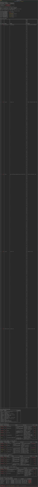

# win11-triage

[](https://github.com/davidzabalaasir-create/Win11_triage/actions/workflows/ci.yml)


[](LICENSE)

Herramienta de **triaje defensivo** para Windows 11. Revisa la persistencia del sistema y los ejecutables de las carpetas de usuario con Sysinternals, consulta su reputación en VirusTotal y genera un informe listo para adjuntar a un ticket.



## Qué hace

| Módulo | Herramienta | Qué busca |
|---|---|---|
| `--autoruns` | `autorunsc` | Entradas de arranque (Run, servicios, tareas, drivers…) **no firmadas por Microsoft** o `(Not verified)` |
| `--scan-user` | `sigcheck` | Ejecutables y DLL **sin firma válida** en `%LOCALAPPDATA%\Temp` y `%APPDATA%` |
| `--network` | `tcpvcon` | Conexiones activas de los procesos señalados |
| `--vt` | API v3 de VirusTotal | Reputación de cada SHA-256, con caché, límite de tasa y lista blanca |

Cada elemento recibe un veredicto:

| | Estado | Criterio |
|---|---|---|
| 🔴 | **DETECTADO** | Al menos un motor de VirusTotal lo marca como malicioso |
| 🟡 | **DESCONOCIDO** | Sin firma o no verificado, y sin veredicto limpio en VT |
| 🟢 | **LIMPIO** | 0 detecciones en VT, o firma válida de un tercero si no se consultó VT |

> [!IMPORTANT]
> Es una herramienta de **triaje**, no un antivirus. Un 🟡 no significa malware y un 🟢 no garantiza que no lo sea: úsala para priorizar qué revisar.

## Instalación

Requisitos: Windows 10/11, Python 3.10+ y las herramientas de Sysinternals.

```powershell
git clone https://github.com/davidzabalaasir-create/Win11_triage.git
cd Win11_triage
python -m pip install .

winget install --id Microsoft.Sysinternals.Autoruns -e
winget install --id Microsoft.Sysinternals.Sigcheck -e
winget install --id Microsoft.Sysinternals.TCPView -e

copy .env.example .env   # y pega tu VT_API_KEY
```

La herramienta busca los `.exe` en `SYSINTERNALS_DIR` (si lo defines en `.env`), en el `PATH` y en la carpeta de WinGet (`%LOCALAPPDATA%\Microsoft\WinGet`). Si falta alguno, muestra cómo instalarlo.

## Uso

Abre la consola **como administrador** (sin elevación, autoruns no ve todas las ubicaciones):

```powershell
win11-triage                    # solo comprueba el entorno
win11-triage --all              # todos los módulos
win11-triage --autoruns --vt    # persistencia + VirusTotal
win11-triage --all --format both --vt-limit 20
win11-triage --dry-run          # demostración con datos de ejemplo (sin red ni herramientas)
```

Sin instalar el paquete: `python win11-triage.py --all`.

| Opción | Descripción |
|---|---|
| `--all` | Activa `--autoruns --scan-user --network --vt` |
| `--vt-limit N` | Máximo de consultas **nuevas** a VT (las de caché no cuentan) |
| `--format md\|json\|both` | Formato del informe (por defecto `md`) |
| `--output-dir DIR` | Carpeta de informes (por defecto `<config-dir>/reportes`) |
| `--config-dir DIR` | Dónde están `.env`, `whitelist.json` y `vt_cache.json` (por defecto `WIN11_TRIAGE_HOME` o la carpeta actual) |
| `--no-report` · `--no-color` · `-v` | Sin informe · sin colores · modo detallado |

### Códigos de salida

| Código | Significado |
|---|---|
| `0` | Sin detecciones (o `--dry-run`) |
| `1` | Entorno incompleto o configuración inválida |
| `2` | Al menos un elemento detectado por VirusTotal |
| `130` | Interrumpido con Ctrl+C |

Así se puede usar en tareas programadas o scripts: `win11-triage --all || echo "Revisar informe"`.

## VirusTotal

- Solo se envía el **hash SHA-256**, nunca el archivo.
- **Caché** en `vt_cache.json`: un hash no se consulta dos veces. Los "no encontrado" se vuelven a consultar a los 7 días y los errores no se guardan.
- **15 s entre peticiones nuevas** para respetar el plan gratuito (4/min). Si VT responde 429, espera 60 s y reintenta una vez.
- Si la clave es inválida (401/403), se detiene y conserva lo ya consultado.

## Lista blanca

`whitelist.json` (se crea vacío la primera vez):

```json
{
  "paths": ["C:\\Program Files\\MiApp\\*", "%APPDATA%\\Zoom\\bin\\Zoom.exe", "D:\\Herramientas\\"],
  "hashes": ["e3b0c44298fc1c149afbf4c8996fb92427ae41e4649b934ca495991b7852b855"]
}
```

- No distingue mayúsculas.
- Admite `*`, variables `%VAR%` y prefijos de carpeta terminados en `\`.

## Informes

Se guardan en `reportes/triage_<equipo>_<fecha>.md` (y `.json` con `--format both`). Incluyen:

- resumen;
- entorno y errores de la ejecución;
- una tabla por módulo;
- detalle plegable de cada elemento: ruta, ubicación de persistencia, firma, SHA-256, enlace a VT y conexiones.

El JSON contiene los mismos datos y está pensado para integrarse con un SIEM o con otros scripts.

## Cómo funciona

```
autorunsc -accepteula -nobanner -a * -c -h -s      → CSV (UTF-16) → filtro no-Microsoft
sigcheck  -accepteula -nobanner -u -e -c -h -s DIR → CSV           → filtro sin firma
tcpvcon   -accepteula -nobanner -c -n              → CSV           → correlación por nombre de imagen
                                     ↓
                     lista blanca → VirusTotal → Rich + Markdown/JSON
```

> [!NOTE]
> La correlación de `--network` se hace por **nombre de ejecutable**, porque tcpvcon no da la ruta completa. Dos binarios con el mismo nombre en rutas distintas se asociarán entre sí.

## Desarrollo

```bash
pip install -e ".[dev]"
pytest                    # tests (no necesitan Windows ni red)
ruff check . && ruff format --check .
python scripts/make_demo.py   # regenera docs/demo.svg
```

```
win11_triage/
├── cli.py          # argumentos y orquestación
├── env_check.py    # localización de Sysinternals y privilegios
├── collectors.py   # ejecución y parseo de autorunsc / sigcheck / tcpvcon
├── virustotal.py   # cliente VT v3 con caché y límite de tasa
├── whitelist.py    # lista blanca
├── report.py       # tablas Rich, Markdown y JSON
├── models.py       # Finding, Connection, Status
└── samples/        # datos de ejemplo para --dry-run y tests
```

## Licencia

[MIT](LICENSE)
