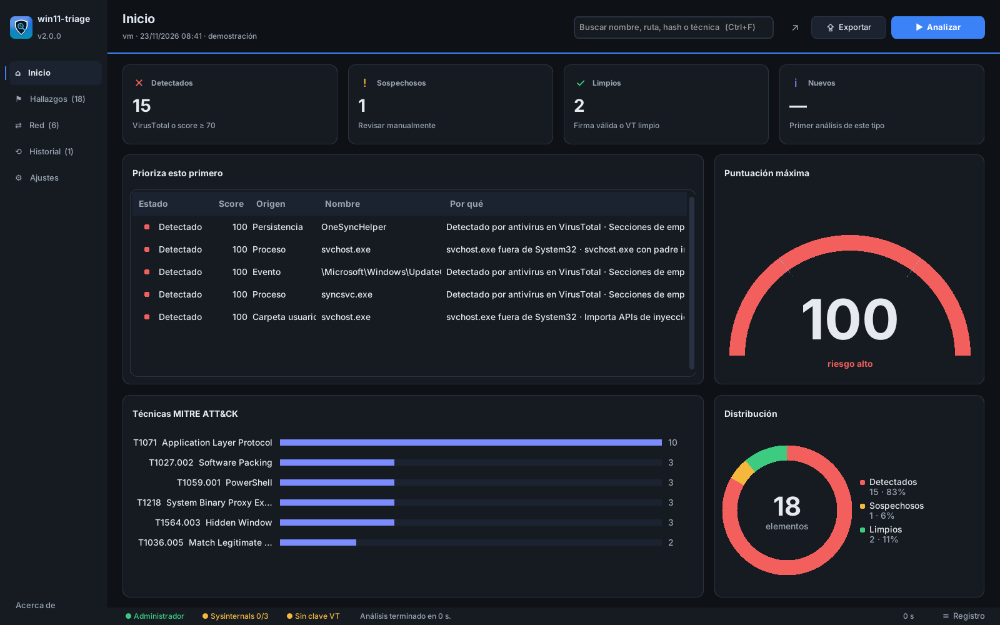
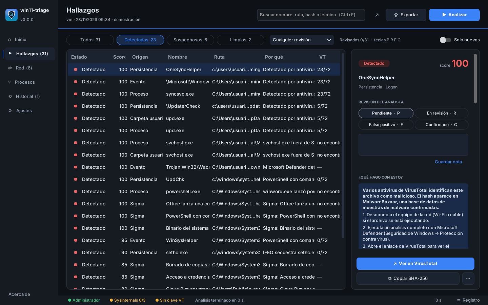
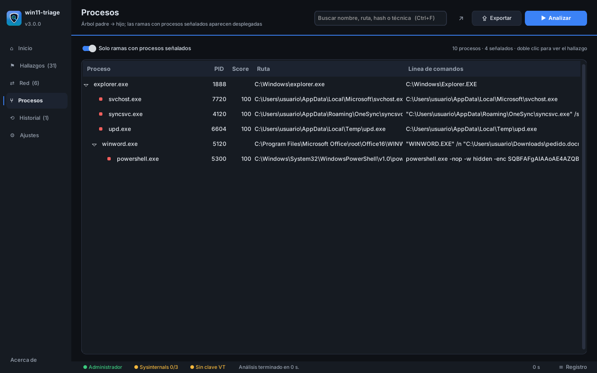
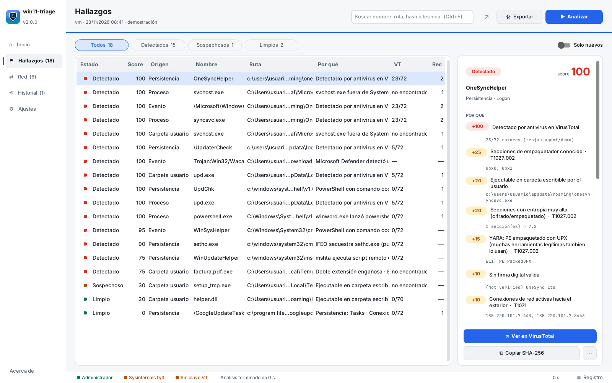

# win11-triage

[](https://github.com/davidzabalaasir-create/Win11_triage/actions/workflows/ci.yml)


[](LICENSE)

Herramienta de **triaje defensivo y respuesta a incidentes** para Windows 11. Examina el equipo en vivo:

- persistencia;
- procesos y conexiones de red;
- eventos de Windows y **reglas Sigma** (con Sysmon si está instalado);
- **extensiones de navegador** (Chrome, Edge, Brave y Firefox);
- contenido de los ejecutables (análisis PE y YARA);
- reputación en VirusTotal, **AbuseIPDB** y **MalwareBazaar**.

Con todo ello, **puntúa cada elemento de 0 a 100 explicando por qué** y lo relaciona con técnicas de **MITRE ATT&CK**.

Para cada hallazgo te dice **«¿Qué hago con esto?»** con pasos concretos, y un **asistente de IA** (Groq gratuito u Ollama local) responde a tus preguntas sobre el análisis. Se usa con **interfaz gráfica** (español o inglés) o desde la **línea de comandos**, en este equipo o en **otros por WinRM**, y puede vigilar el equipo con **análisis programados** que avisan solo de lo nuevo. Es **solo lectura**: nunca borra, termina procesos ni sube ficheros.

🌐 Página del proyecto: <https://davidzabalaasir-create.github.io/Win11_triage/>



## Qué analiza

| Módulo | Fuente | Qué busca |
|---|---|---|
| `--autoruns` | `autorunsc` | Persistencia no firmada por Microsoft **y** abusos de binarios de Microsoft (LOLBins con argumentos peligrosos, WMI, IFEO) |
| `--scan-user` | `sigcheck` | Ejecutables y DLL sin firma válida en `%LOCALAPPDATA%\Temp` y `%APPDATA%` |
| `--processes` | `psutil` | Procesos en rutas de usuario, nombres de sistema suplantados, Office lanzando consolas, padres inesperados, binarios borrados |
| `--events [DÍAS]` | `wevtutil` | Servicios instalados (7045), tareas creadas (4698) y detecciones de Defender (1116/1117) |
| `--network` | `psutil` (`tcpvcon` de respaldo) | Conexiones externas, correlacionadas **por PID y ruta exacta** |
| `--static` | `pefile` + YARA | Empaquetadores, entropía alta, imports de inyección, timestamps imposibles y reglas YARA |
| `--sigma` | Sysmon, Security 4688, PowerShell 4104, System 7045 | **Reglas Sigma** (11 incluidas + las tuyas en `sigma/*.yml`): Office lanzando consolas, LOLBins, borrado de instantáneas, volcado de LSASS, claves Run, DNS a túneles… |
| `--browsers` | Perfiles de Chrome, Edge, Brave y Firefox | Extensiones fuera de la tienda, sin empaquetar o sin firma, con acceso a todos los sitios o permisos peligrosos |
| `--vt` | API v3 de VirusTotal | Reputación de cada SHA-256, con caché y límite de tasa |
| `--intel` | AbuseIPDB · MalwareBazaar | Reputación de las IP remotas y hashes de malware conocido (claves gratuitas en `.env`) |
| `--remote EQUIPO` | PowerShell Remoting (WinRM) | Persistencia, procesos y red de otro equipo, sin instalar nada en él |

### Puntuación y veredicto

Cada regla que se dispara aporta una **señal** con su peso, su técnica ATT&CK y la evidencia concreta. Ejemplo: «PowerShell con comando codificado en Base64, +45, T1059.001, `powershell -nop -w hidden -enc SQBF…`». La puntuación es la suma de los pesos, de 0 a 100.

| | Estado | Criterio |
|---|---|---|
| 🔴 | **DETECTADO** | VirusTotal ≥ 1 motor **o** puntuación ≥ 70 |
| 🟡 | **SOSPECHOSO / SIN FIRMA** | Puntuación 30–69, o sin firma válida |
| 🟢 | **LIMPIO** | Puntuación < 30 y firma válida o VirusTotal limpio |

Una sola señal débil (sin firma, carpeta de usuario) nunca basta para el rojo. Una firma válida resta puntos, salvo que el binario firmado se esté usando de forma maliciosa (por ejemplo, `mshta.exe` lanzando una URL desde la clave Run).

> [!IMPORTANT]
> Es una herramienta de **triaje**, no un antivirus. Sirve para **priorizar** qué revisar primero.

## Instalación

### Opción A: instalador (sin Python)

En [Releases](https://github.com/davidzabalaasir-create/Win11_triage/releases) hay tres formatos, todos firmados digitalmente por **David**:

| Archivo | Para qué |
|---|---|
| `win11-triage-setup-<versión>.exe` | Instalador con asistente. Instala solo para tu usuario, sin pedir administrador, y puede instalar las herramientas de Sysinternals |
| `win11-triage-<versión>.msi` | Instalador MSI para todo el equipo. Sirve para despliegues con GPO, Intune o SCCM: `msiexec /i win11-triage-<versión>.msi /qn` |
| `win11-triage-portable-<versión>.zip` | Sin instalar: descomprimir y ejecutar |

La configuración y los informes se guardan en `%LOCALAPPDATA%\win11-triage`; en la versión portable, en su propia carpeta.

> [!NOTE]
> La firma es de un certificado propio (autofirmado). Windows puede seguir mostrando SmartScreen o bloquearla con el **Control de aplicaciones inteligente** hasta que esté disponible la firma de SignPath Foundation (ver [Firma de código](#firma-de-código)).

### Opción B: desde el código

```powershell
git clone https://github.com/davidzabalaasir-create/Win11_triage.git
cd Win11_triage
python -m pip install ".[yara]"     # sin YARA: python -m pip install .
```

### Herramientas de Sysinternals (en ambos casos)

```powershell
winget install --id Microsoft.Sysinternals.Autoruns -e
winget install --id Microsoft.Sysinternals.Sigcheck -e
winget install --id Microsoft.Sysinternals.TCPView -e   # opcional: respaldo de --network
```

### Clave de VirusTotal (opcional)

Desde la interfaz, en **«Clave de VirusTotal…»**. A mano: `copy .env.example .env` y escribe `VT_API_KEY=tu_clave`. El `.env` está en `.gitignore`: la clave nunca se sube a GitHub.

## Interfaz gráfica

```powershell
win11-triage-gui          # o: win11-triage --gui · o desde el menú Inicio si usaste el instalador
```



| Zona | Qué hay |
|---|---|
| **Barra lateral** | Inicio · Hallazgos · Red · Procesos · Historial · Ajustes, con contadores. |
| **Barra superior** | Título de la página, búsqueda (nombre, ruta, hash o técnica como `T1059.001`), Exportar y el botón principal **Analizar**, que se convierte en **Cancelar** mientras analiza. |
| **Nuevo análisis** | Perfiles **Rápido**, **Completo** o **Personalizado**; módulos agrupados en *Recolección* y *Enriquecimiento*; días de eventos, límite de VirusTotal, formato del informe y modo demostración. Recuerda la última configuración. |
| **Inicio** | KPIs con la tendencia frente al análisis anterior, «Prioriza esto primero», puntuación máxima, técnicas ATT&CK y distribución. |
| **Hallazgos** | Filtros con contador, «Solo nuevos», tabla ordenable y **panel de detalle lateral**. El panel muestra **«¿Qué hago con esto?»**, el porqué con el peso y la evidencia de cada señal, y los datos del archivo, la ejecución, la red y VirusTotal. |
| **Procesos** | **Árbol padre → hijo** con las ramas sospechosas desplegadas; doble clic salta al hallazgo. |
| **Ajustes** | Claves (VirusTotal, AbuseIPDB, MalwareBazaar), apariencia e **idioma** (español / inglés), **alertas** (notificación de Windows y webhook), **análisis programado**, herramientas (con instalación por winget), lista blanca, reglas YARA y carpetas. |
| **Barra de estado** | Estado del entorno (administrador, Sysinternals, VirusTotal), progreso y el **Registro** plegable (`Ctrl+L`). |

**Flujo de trabajo del analista:**
- **Revisión:** marca cada elemento como *Pendiente*, *En revisión*, *Falso positivo* o *Confirmado* con las teclas `P` `R` `F` `C` o desde el detalle, y añade notas.
  - Se guarda en `review.json` y se recuerda si el mismo elemento vuelve a aparecer.
  - Sale en los informes y en el CSV.
  - Puedes filtrar la tabla por estado de revisión.
- **Comparar análisis:** en Historial, «Comparar con el actual» muestra los elementos nuevos, los resueltos y los que empeoran o mejoran (±10 puntos).
- **Paquete de evidencias:** Exportar → «Paquete de evidencias (.zip)» incluye los informes HTML, MD y JSON, el CSV, las revisiones, los IoC SHA-256, un `LEEME.txt` y un `SHA256SUMS.txt` para verificar la integridad. No incluye los ficheros sospechosos.
- **Actualizaciones:** Ajustes → «Buscar actualizaciones». Solo se consulta GitHub cuando lo pides.

**Detalles de uso:**
- Ignorar una ruta o un hash se aplica al momento y se puede **deshacer** desde el aviso.
- Copiar un hash confirma en el propio botón.
- Al terminar un análisis aparece un aviso con acceso directo a lo detectado.

**Atajos:**
- `Ctrl+N` nuevo análisis · `Ctrl+R` repetir el último · `Esc` cancelar
- `Ctrl+F` buscar · `Ctrl+E` exportar CSV · `Ctrl+O` abrir informe
- `Ctrl+1…6` páginas · `F5` volver a comprobar las herramientas

<details><summary>Árbol de procesos</summary>



</details>

<details><summary>Tema claro</summary>



</details>

## Línea de comandos


```powershell
win11-triage                          # solo comprueba el entorno
win11-triage --all                    # todos los módulos
win11-triage --autoruns --processes --network   # triaje rápido sin red externa
win11-triage --events 30              # servicios, tareas y Defender de los últimos 30 días
win11-triage --all --format all --vt-limit 20
win11-triage --dry-run --explain      # demostración con datos de ejemplo y pasos recomendados
win11-triage --sigma --browsers --intel          # reglas Sigma, extensiones y reputación
win11-triage --remote PC-01 --remote-user CORP\\ana  # otro equipo por WinRM
win11-triage --schedule daily --at 08:30         # análisis diario que solo avisa de novedades
win11-triage --all --webhook https://hooks.slack.com/… --alert-new --notify
win11-triage --all --lang en --format pdf        # resumen ejecutivo en inglés
```

| Opción | Descripción |
|---|---|
| `--all` | Activa todos los módulos |
| `--vt-limit N` | Máximo de consultas **nuevas** a VirusTotal (las de caché no cuentan); se consulta primero lo más grave |
| `--vt-all` | Consulta también lo firmado por editores de confianza sin señales (por defecto se omite para ahorrar tiempo) |
| `--quick` | Análisis rápido: autorunsc sin códecs, gadgets, complementos de IE ni Known DLLs (también el perfil «Rápido» de la app) |
| `--format md\|html\|json\|pdf\|both\|all` | Formato del informe (`pdf` = resumen ejecutivo de una página, `both` = md + json, `all` = todos) |
| `--explain` | «¿Qué hago con esto?» para los 5 elementos más graves |
| `--lang es\|en` | Idioma de los informes y mensajes (también `WIN11_TRIAGE_LANG`) |
| `--notify` · `--webhook URL` · `--jsonl FICHERO` | Notificación de Windows · Slack, Teams, Splunk HEC o JSON genérico · JSON Lines para Wazuh/Filebeat |
| `--alert-new` | Las alertas incluyen solo lo nuevo o lo que empeora respecto al análisis anterior |
| `--schedule daily\|weekly\|off\|status` · `--at HH:MM` | Análisis programado con el Programador de tareas |
| `--remote EQUIPO` · `--remote-user U` · `--remote-ssl` | Triaje remoto por WinRM (5985, o 5986 con SSL) |
| `--output-dir DIR` / `--config-dir DIR` | Carpeta de informes / de `.env`, `whitelist.json`, `vt_cache.json` y `yara/` |
| `--evidence` | Además, paquete de evidencias `.zip` |
| `--min-score N` | Muestra e informa solo los elementos con score ≥ N |
| `--fail-on-score N` | Código de salida 2 si algún elemento llega a N (para pipelines y tareas programadas) |
| `--check-update` | Comprueba si hay una versión nueva |
| `--no-report` · `--no-color` · `-v` · `--gui` | Sin informe · sin colores · detallado · abrir la interfaz |

**Códigos de salida:**
- `0`: nada detectado.
- `1`: entorno incompleto.
- `2`: hay elementos detectados.
- `130`: interrumpido.

Sirven para tareas programadas o pipelines.

## Asistente de IA

Pregunta en lenguaje natural sobre un análisis: «¿qué reviso primero?», «¿estoy infectado?», «explícame este hallazgo».

```powershell
win11-triage --all --ask "¿Qué debería revisar primero?"
win11-triage --report reportes\triage_PC_20261123_0930.json --ask "¿Es grave lo de sethc.exe?"
```

En la interfaz: página **Asistente** (con preguntas sugeridas) y la clave en **Ajustes → Asistente de IA**.

| Proveedor | Coste | Configuración (`.env`) |
|---|---|---|
| **Groq** (por defecto, modelo `openai/gpt-oss-120b`) | Gratis con límites diarios | `GROQ_API_KEY` ([crear clave](https://console.groq.com/keys)) |
| **Ollama** (en tu PC, sin Internet) | Gratis | `AI_PROVIDER=ollama` y `AI_MODEL=llama3.1` |
| Otro compatible con OpenAI | Según el servicio | `AI_BASE_URL`, `AI_MODEL`, `AI_API_KEY` |

**Privacidad y seguridad:**
- Se envía un **resumen** del análisis. El detalle de un hallazgo solo se envía cuando el asistente lo pide.
- El usuario de Windows y el nombre del equipo se sustituyen por `<usuario>` y `<equipo>`.
- Nunca se envían ficheros.
- El asistente solo tiene herramientas de **lectura**: listar y ver hallazgos, cadenas de procesos y proponer una entrada de lista blanca, que no aplica. No puede cambiar nada del equipo.

## Informes

En `reportes/triage_<equipo>_<fecha>.{html,md,json}`. Incluyen:

- resumen;
- **«Prioriza esto primero»** (los 5 elementos de mayor puntuación);
- tabla de **técnicas ATT&CK** con enlaces a attack.mitre.org;
- una tabla por módulo con su puntuación y el «por qué»;
- detalle de cada elemento con sus señales (peso, técnica y evidencia), sus conexiones, VirusTotal y la **revisión del analista**;
- **cronología**: los elementos con fecha, ordenados del más reciente al más antiguo.

El **PDF ejecutivo** (`--format pdf`) resume en una página el veredicto, las cifras, lo más grave con qué hacer y las técnicas observadas, para quien tiene que decidir. El **HTML** es un único archivo con todo el detalle, incluido «¿Qué hago con esto?» y las **cadenas de procesos sospechosos**. El **JSON** (`schema_version: 2`) está pensado para SIEM y automatización:

```json
{ "schema_version": 2, "max_score": 100,
  "attack": [{"id": "T1059.001", "name": "PowerShell", "count": 3}],
  "findings": [{ "source": "autoruns", "name": "UpdChk", "status": "DETECTADO", "score": 100,
                 "signals": [{"id": "CMD_PS_ENCODED", "weight": 45, "attack": "T1059.001", "evidence": "powershell … -enc …"}],
                 "attack": ["T1059.001", "T1071", "T1218", "T1546.003", "T1564.003"] }] }
```

## Configuración

| Archivo | Para qué |
|---|---|
| `.env` | `VT_API_KEY`; opcionales: `ABUSEIPDB_API_KEY`, `MALWAREBAZAAR_API_KEY`, `WIN11_TRIAGE_WEBHOOK`, `SPLUNK_HEC_TOKEN`, `SYSINTERNALS_DIR` |
| `sigma/*.yml` | Tus reglas Sigma (formato estándar: `logsource`, `detection`, `condition`, modificadores `contains`/`startswith`/`endswith`/`all`/`re`/`cidr`) |
| `whitelist.json` | `paths` (admite `*`, `%VAR%` y carpetas terminadas en `\`), `hashes` y `publishers` (solo se aplica a elementos con firma válida) |
| `yara/*.yar` | Tus reglas YARA. Se suman a las incluidas; usa `meta: description`, `mitre` y `weight` |
| `vt_cache.json` | Caché de VirusTotal. Los «no encontrado» caducan a los 7 días |

## Falsos positivos conocidos

| Señal | Puede saltar con | Qué hacer |
|---|---|---|
| Carpeta de usuario | Teams, Zoom, Discord, Spotify (viven en AppData) | Si están firmados quedan en 🟢. Si no, `publishers` o `paths` en la lista blanca |
| Sin firma | Scripts internos, herramientas portables | Por sí sola solo da 🟡 |
| Empaquetador / entropía | Instaladores (NSIS, Inno), protectores anti-trampas | Peso bajo: necesita otras señales para llegar al rojo |
| Imports de inyección | Depuradores, antivirus, overlays (Discord, NVIDIA) | Lista blanca por editor firmado |
| PowerShell oculto | Intune/SCCM, scripts de inicio corporativos | Lista blanca por hash o ruta |
| Evento 4698 | Requiere la auditoría «Otros eventos de objetos» | Se informa como «no disponible», nunca como «sin tareas» |

**Limitaciones:**
- Sin acceso a kernel ni a memoria, un rootkit puede esconderse.
- Sin privilegios de administrador se ve menos.
- La herramienta no ejecuta muestras.

## Desarrollo

```bash
pip install -e ".[dev,yara]"
pytest                          # 100+ tests; no necesitan Windows ni red
ruff check . && ruff format --check .
python scripts/make_demo.py     # regenera docs/demo.svg
python scripts/make_icon.py     # regenera el logo
```

Ejecutables (en Windows): `powershell -ExecutionPolicy Bypass -File scripts\build_exe.ps1`. La CI los compila en cada cambio y los adjunta a la release al publicar un tag `v*`.

```
win11_triage/
├── engine.py              # orquesta: colectores → reglas → red → contenido → VT → veredicto
├── collectors.py          # autorunsc / sigcheck / tcpvcon
├── collectors_live.py     # procesos y conexiones (psutil)
├── collectors_events.py   # eventos 7045 / 4698 / Defender (wevtutil)
├── enrich/                # análisis PE (pefile) y YARA
├── rules/                 # heurísticas, ATT&CK y reglas YARA incluidas
├── virustotal.py          # cliente VT v3 con caché y límite de tasa
├── report.py              # Rich, Markdown, HTML y JSON v2
├── gui/                   # interfaz (CustomTkinter): app, gráficos, historial
└── samples/               # datos de ejemplo para --dry-run y tests
```

## Firma de código

Los binarios (`.exe`, `.dll`, `.pyd`, el instalador y el `.msi`) se firman con un certificado **«David»** con sello de tiempo. En sus propiedades (clic derecho → Propiedades → Firmas digitales) aparece «David».

- **Certificado propio (gratis).** El autor lo crea una vez en su PC con `scripts\new_signing_cert.ps1 -Trust` y lo guarda como secretos de GitHub (`WIN11_TRIAGE_PFX` y `WIN11_TRIAGE_PFX_PASSWORD`). Desde entonces la CI firma con él cada compilación. Si el secreto no existe, la CI firma con un certificado «David» temporal.
  - Al ser autofirmado, **solo es de confianza en los equipos donde se importe** `win11-triage-david.cer`.
  - **No evita** SmartScreen ni el Control de aplicaciones inteligente en otros equipos.
- **SignPath Foundation (solicitado, gratis).** Certificado de confianza pública para proyectos de código abierto: [SignPath.io](https://about.signpath.io/), certificado de [SignPath Foundation](https://signpath.org/). Ver la [política de firma](CODE_SIGNING_POLICY.md).
- **Certum (opcional, de pago).** `scripts\sign_release.ps1` firma la versión portable con un certificado de Certum y reconstruye el instalador.

### Publicar una versión

Con un tag `v*`, o desde **Actions → CI → Run workflow** indicando `release_tag` (p. ej. `v2.0.0`): la CI compila, prueba el instalador y publica la release con el instalador y la versión portable.

## Licencia

© 2026 David. Publicado bajo licencia [MIT](LICENSE).
